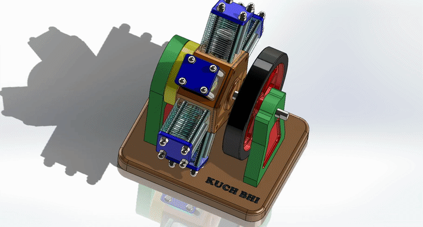

# 6 Cylinder Radial Engine - CAD Design and Motion Analysis (SolidWorks)
3D CAD model of a radial engine assembly with a SolidWorks Motion Study, developed for BluePrint 2k24-25 at MNNIT Allahabad.

[](https://www.solidworks.com/)
[](https://www.solidworks.com/)
[](#competition)

---

## Overview : 

This project is the complete 3D model of a **6-Cylinder Radial Engine** built in SolidWorks, assembled as a fully mated multi-body assembly and animated using a SolidWorks Motion Analysis to verify that the mechanism moves correctly.

## Competition : 

- **Event Name:** BluePrint 2k24-25, organized by Mechrocosm under the Avishkar Technical Fest, MNNIT Allahabad
- **Category:** 2nd Year
- **Team:** Kuch Bhi👾
- **Result:** 3rd Position
- **Round:** Qualifier (6 Cylinder Radial Engine Design)

---

## CAD Model (Solidworks) : 

<div align="center">
  
  <p> <i>Rendered view of 6 Cyliner Radial Engine assembly.</i></p>
</div>

---

## Motion Analysis :

Motion study set up in SolidWorks Motion Study:

- **Driver:** Rotary motor on Crankshaft Rod.
- **Speed:** 100 RPM
- **Duration:** 10 seconds
- **Output:** Animation (in .mp4 and.gif) in Motion_Analysis folder.

Demo video: `Motion_Analysis/Motion Analysis.mp4`
<div align="center">
  
  <p><i>Motion Analysis of 6 Cyliner Radial Engine assembly.</i></p>
</div>

---

## Bill of Materials (BOM) : 

| ITEM NO. | COMPONENT NAME | FILE TYPE | QTY. |
| :---: | :--- | :--- | :---: |
| 1 | Base | `.SLDPRT` | 1 |
| 2 | Piller Support | `.SLDPRT` | 1 |
| 3 | Bearing Support | `.SLDPRT` | 1 |
| 4 | Valve Housing | `.SLDPRT` | 1 |
| 5 | Valve | `.SLDPRT` | 1 |
| 6 | Crankcase | `.SLDPRT` | 1 |
| 7 | Sub Assembled Crankshaft | `.SLDASM` | 1 |
|  |    Counter Weight | `.SLDPRT` | 2 |
|  |    Crankshaft Pin | `.SLDPRT` | 1 |
|  |     Crankshaft Rod | `.SLDPRT` | 1 |
| 8 | Crankshaft Valve Crank | `.SLDPRT` | 1 |
| 9 | SKF - 6001 - Full, DE, AC, Full_68 | `.SLDPRT` | 3 |
| 10 | Connecting Rod Hub | `.SLDPRT` | 1 |
| 11 | Crankcase Gasket | `.SLDPRT` | 1 |
| 12 | Crankcase Cover | `.SLDPRT` | 1 |
| 13 | Hub Pin | `.SLDPRT` | 6 |
| 14 | Cylinder Body | `.SLDPRT` | 6 |
| 15 | Cyinder Bolt | `.SLDPRT` | 24 |
| 16 | Cylinder Cover | `.SLDPRT` | 6 |
| 17 | Connecting Rod | `.SLDPRT` | 6 |
| 18 | Sub Assembled Piston | `.SLDASM` | 6 |
|  |    Piston | `.SLDPRT` | 1 |
|  |    Piston Pin | `.SLDPRT` | 1 |
|  |    Piston Ring | `.SLDPRT` | 2 |
| 19 | DIN 1587 - M6 --NNU | `.SLDPRT` | 24 |
| 20 | ISO 4762 M6 x 45 - 45S | `.SLDPRT` | 6 |
| 21 | Flywheel | `.SLDPRT` | 1 |

---

## Repository Structure : 

```
Six-Cylinder-Radial-Engine/
├── BOM/                    # Bill of Materials (in .xlsx and pdf)
├── CAD_Files/              # Contains all individual .SLDPRT part files and master .SLDASM file
├── Motion_Analysis         # Contains motion analysis (mp4 and gif)
├── Renders/                # Visual 3D render image of the assembly
└── README.md               # Project documentation page
```

## Credits : 

**Team:** Kuch Bhi👾, BluePrint 2k24-25, Mechrocosm Event, MNNIT Allahabad.

## License :

Shared for educational and portfolio purposes.
